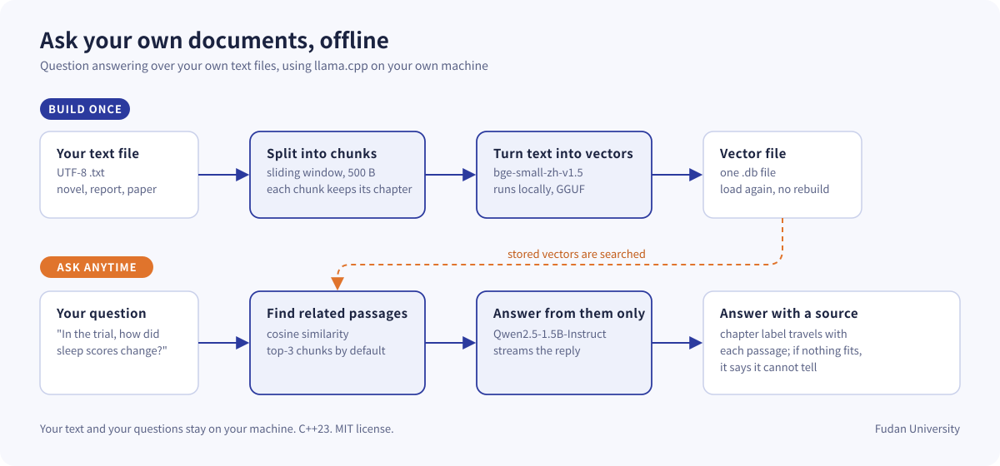
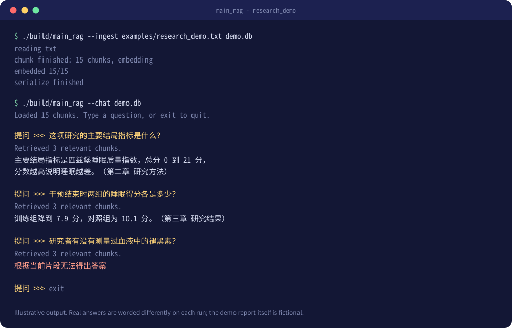

<div align="center">

# local-rag-cpp

**对着自己的文本文件提问，答案出自原文，全程在你自己的电脑上运行。**

**刘瑞琦（Rachael Liu）**<sup>1</sup> · **沈曹依（Philie Shen）**<sup>1</sup>

<sup>1</sup> 复旦大学（Fudan University） · [24301050114@m.fudan.edu.cn](mailto:24301050114@m.fudan.edu.cn) · [25303050175@m.fudan.edu.cn](mailto:25303050175@m.fudan.edu.cn)

[English](README.md) · [操作指南](docs/GUIDE.md) · [示例](examples/) · [许可证](LICENSE)




</div>

## 摘要

local-rag-cpp 是一个针对单个文本文件的小型问答工具。它把文本切成带重叠的段落，用中文嵌入模型转成向量，存进一个二进制文件。提问时按余弦相似度取出最接近的几段，交给 1.5B 的指令模型作答。两个模型都通过 llama.cpp 的 C 接口运行，下载完成后数据不会离开本机。仓库自带一份虚构的研究报告和《三国演义》前十回作为示例。

## 这是什么

给它一个 `.txt` 文件，它会把文本切成短段落，存成一个数据库文件。之后你可以在终端里随便提问：程序先找出最相关的几段，再请一个小型语言模型只根据这几段来回答。

程序直接调用 llama.cpp 的 C 接口，不需要 Python，也不需要任何网络服务。两个模型文件下载好之后，断网也能用。

- **答案贴着原文。** 提示词要求模型只用检索到的段落作答，段落里没有答案时就说不知道。
- **段落记得自己在哪一章。** 读文本时会识别"第三章"、`Chapter 3` 这类标题，每段都带着标题交给模型。
- **建一次，问很多次。** 数据库是一个二进制文件，下次直接加载，不用重新计算。
- **容易调整。** 段落大小、每次取几段、采样参数都写在 `config.json` 里，聊天时输入 `/reload` 就能生效。

> 小模型会出错。1.5B 的模型可能不听指令、凭印象作答，也可能漏掉分散在几处的信息。重要的答案请对照原文核实。

## 快速开始

需要一台 Linux 机器、CMake 3.22 以上，以及 **GCC 14 以上**（代码用了 C++23 的 `<print>` 头文件，GCC 13 没有）。怎么检查和安装见[操作指南](docs/GUIDE.md#1-环境要求)。

```bash
# 1. 获取代码。llama.cpp 已经放在 llama_src/ 里，不需要 --recursive
git clone https://github.com/rachael1216/local-rag-cpp.git
cd local-rag-cpp

# 2. 把两个模型下载到 models/（合计约 1.2 GB）
mkdir -p models
wget -P models https://huggingface.co/CompendiumLabs/bge-small-zh-v1.5-gguf/resolve/main/bge-small-zh-v1.5-f16.gguf
wget -P models https://huggingface.co/Qwen/Qwen2.5-1.5B-Instruct-GGUF/resolve/main/qwen2.5-1.5b-instruct-q4_k_m.gguf

# 3. 编译。第一次会连 llama.cpp 一起编译，要几分钟
cmake -S . -B build -DCMAKE_BUILD_TYPE=Release
cmake --build build -j4

# 4. 建库，然后提问
./build/main_rag --ingest examples/research_demo.txt demo.db
./build/main_rag --chat demo.db
```

请在仓库根目录运行。程序按启动时所在的目录去找 `config.json` 和模型文件。

## 示例一：一份研究报告

`examples/research_demo.txt` 是一份中文的短报告，讲一项编出来的试验：八周正念训练对睡眠不好的大学生有没有帮助。它分六章，正好能看到章节标签怎么起作用。**这项研究是虚构的**，数字都是为演示编的，请不要引用。

<div align="center">

</div>

图是示意，不是实际录屏。真实运行时每次的措辞都不一样。

最后一个问题是故意设的陷阱：报告里从没提过褪黑素，正确的回答是"片段里没有说"。更多可以直接试的问题按类型整理在 [examples/research-demo.md](examples/research-demo.md)。

## 示例二：《三国演义》

`novel.txt` 收录了这部名著的前十回，从桃园结义到曹操崛起，篇幅更长，章节结构清楚。

```bash
./build/main_rag --ingest novel.txt novel.db
./build/main_rag --chat novel.db
```

适合问的是这十回之内发生的事，比如桃园结义是哪三个人，张飞为什么鞭打督邮。官渡、赤壁这些后面的情节不在文件里，模型应该拒绝回答。详见 [examples/三国演义问答.md](examples/三国演义问答.md)。

## 换成你自己的文本

把文本存成 UTF-8，让每个章节标题单独占一行，并以"第…章"、"第…回"、"第…节"、"第…卷"或 `Chapter N` 开头，然后照上面的方式运行 `--ingest` 和 `--chat`。编码不对会出现乱码，可以先转换，例如 `iconv -f GBK -t UTF-8 旧文件.txt > 新文件.txt`。

默认的嵌入模型 bge-small-zh 是为中文训练的。处理英文等其他语言时，需要在 `config.json` 里换成别的 GGUF 嵌入模型并重新建库。理论上可行，但我们没有测试过。

## 工作原理

1. **读取。** 逐行读入文本，把像章节标题的行连同位置记下来。
2. **切分。** 用滑动窗口切成约 500 字节（大约 160 个汉字）的段落，相邻段落重叠 50 字节。切口会退回到窗口末尾 100 个字符内最近的标点或换行处，也不会落在一个汉字的中间。
3. **转成向量。** bge 模型把每段文字变成一个向量。段落、章节标题和向量一起写进一个二进制文件。
4. **检索。** 提问时用同一个模型生成问题的向量，与库里每个向量逐个计算余弦相似度，用一个小的最小堆留下最高的三个。这是直接遍历，几百段没问题，几百万段就会慢。
5. **回答。** 三个段落和问题拼成提示词交给 Qwen2.5-1.5B-Instruct，生成一个字就打印一个字。

类的设计见 [DESIGN.md](DESIGN.md)。

## 常用设置

| `config.json` 里的字段 | 默认值 | 含义 |
| --- | --- | --- |
| `document.chunk_size` | 500 | 段落大小，单位是字节，一个汉字约 3 字节 |
| `document.overlap_size` | 50 | 相邻段落共有的部分 |
| `retrieval.top_k` | 3 | 每次提问交给模型几段 |
| `generation.max_output_tokens` | 512 | 一次回答的长度上限 |
| `generation.temperature` | 0.7 | 越低，回答越稳定 |
| `models.n_gpu_layers` | 99 | 放到 GPU 上的层数，纯 CPU 编译时无效 |

改了 `document.*` 或更换嵌入模型后要重新建库，其他字段 `/reload` 就能生效。完整说明见[操作指南](docs/GUIDE.md#4-配置说明)。

## 已知限制

- 输入必须是 UTF-8 编码，一次只能载入一个文本文件。
- 纯 CPU 下生成速度较慢。
- 检索比较的是语义，所以不能回答需要在整本书里计数、统计的问题。
- 切分只看 `. ! ? ， 。 ！ ？` 和换行，很长的对话仍可能被切在不合适的地方。
- 聊天时 `document.*` 的修改不会热加载。
- 目标环境是装有 GCC 14 以上的 Linux，macOS 和 Windows 没有试过。

## 目录结构

```text
src/               源码（读取、切分、向量化、检索、生成）
llama_src/         llama.cpp 源码
json_include/      nlohmann/json 头文件
config.json        设置
novel.txt          示例二
examples/          示例一和问题清单
docs/              操作指南、第三方声明、图示
DESIGN.md          类的设计
```

## 联系方式

刘瑞琦：[24301050114@m.fudan.edu.cn](mailto:24301050114@m.fudan.edu.cn)。沈曹依：[25303050175@m.fudan.edu.cn](mailto:25303050175@m.fudan.edu.cn)。也欢迎在 GitHub 上提 issue。

## 引用

如果这个项目对你的工作有帮助，可以这样引用。仓库里也有 `CITATION.cff`，GitHub 会据此显示"Cite this repository"按钮。

```bibtex
@software{liu_shen_cpp_local_rag_2026,
  author  = {Liu, Rachael and Shen, Philie},
  title   = {local-rag-cpp: a local question answering tool for your own text files},
  year    = {2026},
  url     = {https://github.com/rachael1216/local-rag-cpp},
  license = {MIT}
}
```

## 许可证

本仓库的代码以 [MIT 许可证](LICENSE)发布。版权所有 © 2026 刘瑞琦、沈曹依，复旦大学。

llama.cpp 和 nlohmann/json 同样是 MIT 许可。模型需要另外下载，各有各的许可条款，详见 [docs/THIRD_PARTY.md](docs/THIRD_PARTY.md)。

## 致谢

感谢 [llama.cpp](https://github.com/ggml-org/llama.cpp) 提供推理代码，感谢 [nlohmann/json](https://github.com/nlohmann/json) 解析配置，也感谢 [BGE](https://huggingface.co/BAAI/bge-small-zh-v1.5) 和 [Qwen2.5](https://huggingface.co/Qwen/Qwen2.5-1.5B-Instruct) 背后的团队。
